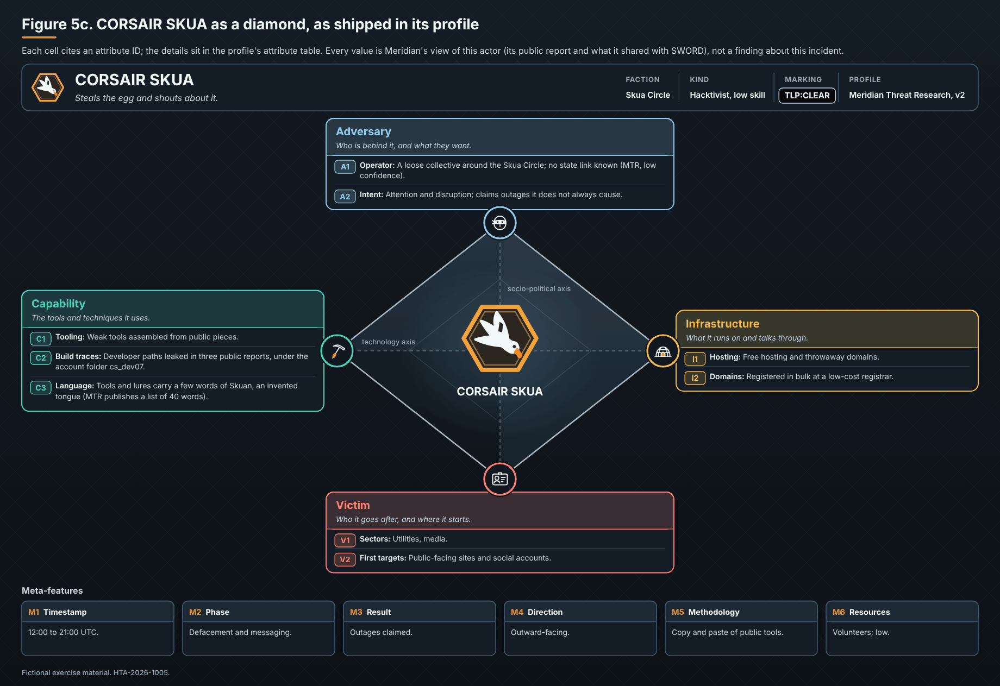

# CORSAIR SKUA

*Profile v2 · TLP:CLEAR.*

- **Calling card.** Steals the egg and shouts about it.
- **Faction.** Skua Circle
- **Kind.** Hacktivist, low skill
- **Wants.** Attention, outages
- **Hours (UTC).** 12:00 to 21:00
- **Public record.** Leaked developer paths in three public reports

## Attribute details

| ID | Attribute | Detail |
|---|---|---|
| A1 | Operator | A loose collective around the Skua Circle; no state link known (MTR, low confidence). |
| A2 | Intent | Attention and disruption; claims outages it does not always cause. |
| C1 | Tooling | Weak tools assembled from public pieces. |
| C2 | Build traces | Developer paths leaked in three public reports, under the account folder `cs_dev07`. |
| C3 | Language | Tools and lures carry a few words of **Skuan**, an invented tongue (MTR publishes a list of 40 words). |
| I1 | Hosting | Free hosting and throwaway domains. |
| I2 | Domains | Registered in bulk at a low-cost registrar. |
| V1 | Sectors | Utilities, media. |
| V2 | First targets | Public-facing sites and social accounts. |
| M1 | Timestamp | 12:00 to 21:00 UTC. |
| M2 | Phase | Defacement and messaging. |
| M3 | Result | Outages claimed. |
| M4 | Direction | Outward-facing. |
| M5 | Methodology | Copy and paste of public tools. |
| M6 | Resources | Volunteers; low. |
