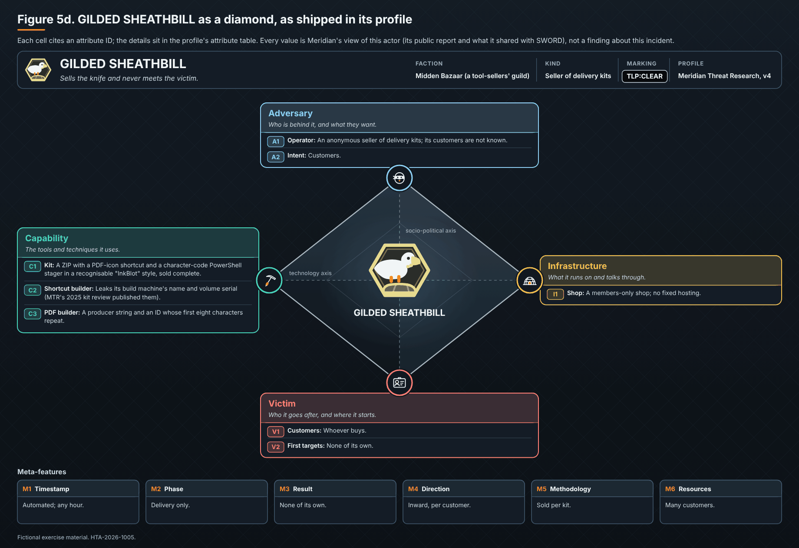

# GILDED SHEATHBILL

*Profile v4 · TLP:CLEAR.*

- **Calling card.** Sells the knife and never meets the victim.
- **Faction.** Midden Bazaar (a tool-sellers' guild)
- **Kind.** Seller of delivery kits
- **Wants.** Customers
- **Hours (UTC).** Automated
- **Public record.** A 2025 kit review with a build machine ID

## Attribute details

| ID | Attribute | Detail |
|---|---|---|
| A1 | Operator | An anonymous seller of delivery kits; its customers are not known. |
| A2 | Intent | Customers. |
| C1 | Kit | A ZIP with a PDF-icon shortcut and a character-code PowerShell stager in a recognisable "InkBlot" style, sold complete. |
| C2 | Shortcut builder | Leaks its build machine's name and volume serial (MTR's 2025 kit review published them). |
| C3 | PDF builder | A producer string and an ID whose first eight characters repeat. |
| I1 | Shop | A members-only shop; no fixed hosting. |
| V1 | Customers | Whoever buys. |
| V2 | First targets | None of its own. |
| M1 | Timestamp | Automated; any hour. |
| M2 | Phase | Delivery only. |
| M3 | Result | None of its own. |
| M4 | Direction | Inward, per customer. |
| M5 | Methodology | Sold per kit. |
| M6 | Resources | Many customers. |
