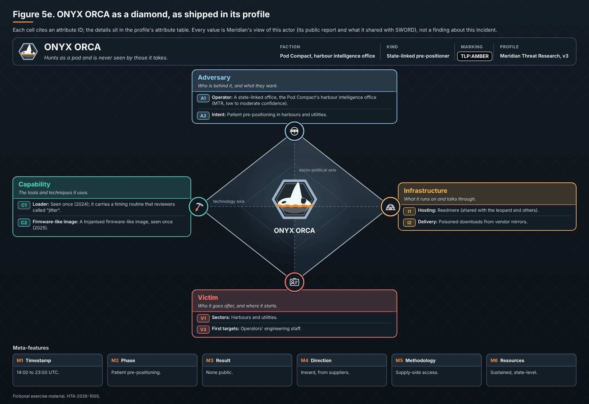

# ONYX ORCA

*Profile v3 · TLP:AMBER.*

- **Calling card.** Hunts as a pod and is never seen by those it takes.
- **Faction.** Pod Compact, harbour intelligence office
- **Kind.** State-linked pre-positioner
- **Wants.** A foothold in harbours and utilities
- **Hours (UTC).** 14:00 to 23:00
- **Public record.** Two reports on hosting and victims

## Attribute details

| ID | Attribute | Detail |
|---|---|---|
| A1 | Operator | A state-linked office, the Pod Compact's harbour intelligence office (MTR, low to moderate confidence). |
| A2 | Intent | Patient pre-positioning in harbours and utilities. |
| C1 | Loader | Seen once (2024); it carries a timing routine that reviewers called "jitter". |
| C2 | Firmware-like image | A trojanised firmware-like image, seen once (2025). |
| I1 | Hosting | Reedmere (shared with the leopard and others). |
| I2 | Delivery | Poisoned downloads from vendor mirrors. |
| V1 | Sectors | Harbours and utilities. |
| V2 | First targets | Operators' engineering staff. |
| M1 | Timestamp | 14:00 to 23:00 UTC. |
| M2 | Phase | Patient pre-positioning. |
| M3 | Result | None public. |
| M4 | Direction | Inward, from suppliers. |
| M5 | Methodology | Supply-side access. |
| M6 | Resources | Sustained, state-level. |
